<a href="https://hexese.com"><picture><source media="(prefers-color-scheme: dark)" srcset="assets/hero-dark.svg"><source media="(prefers-color-scheme: light)" srcset="assets/hero-light.svg"></picture></a>

I study Computer Science (B.Sc.) at Goethe University Frankfurt and I'm looking for a working-student position in software engineering. Alongside my studies I run [Hexese](https://hexese.com), my software studio, where I'm building Amtsorakel.

<picture><source media="(prefers-color-scheme: dark)" srcset="assets/head-projects-dark.svg"><source media="(prefers-color-scheme: light)" srcset="assets/head-projects-light.svg"></picture>

<a href="https://amtsorakel.de"><picture><source media="(prefers-color-scheme: dark)" srcset="assets/card-amtsorakel-dark.svg"><source media="(prefers-color-scheme: light)" srcset="assets/card-amtsorakel-light.svg"></picture></a>
<a href="https://hexese.com"><picture><source media="(prefers-color-scheme: dark)" srcset="assets/card-hexese-dark.svg"><source media="(prefers-color-scheme: light)" srcset="assets/card-hexese-light.svg"></picture></a>

The repositories for Amtsorakel and hexese.com are private.

<picture><source media="(prefers-color-scheme: dark)" srcset="assets/head-exercises-dark.svg"><source media="(prefers-color-scheme: light)" srcset="assets/head-exercises-light.svg"></picture>

<a href="https://aaronkuy.github.io/typing-trainer/"><picture><source media="(prefers-color-scheme: dark)" srcset="assets/ex-typing-trainer-dark.svg"><source media="(prefers-color-scheme: light)" srcset="assets/ex-typing-trainer-light.svg"></picture></a> <a href="https://aaronkuy.github.io/weather/"><picture><source media="(prefers-color-scheme: dark)" srcset="assets/ex-weather-dark.svg"><source media="(prefers-color-scheme: light)" srcset="assets/ex-weather-light.svg"></picture></a>
<a href="https://aaronkuy.github.io/book-finder/"><picture><source media="(prefers-color-scheme: dark)" srcset="assets/ex-book-finder-dark.svg"><source media="(prefers-color-scheme: light)" srcset="assets/ex-book-finder-light.svg"></picture></a> <a href="https://aaronkuy.github.io/music-player/"><picture><source media="(prefers-color-scheme: dark)" srcset="assets/ex-music-player-dark.svg"><source media="(prefers-color-scheme: light)" srcset="assets/ex-music-player-light.svg"></picture></a>
<a href="https://aaronkuy.github.io/journaling/"><picture><source media="(prefers-color-scheme: dark)" srcset="assets/ex-journaling-dark.svg"><source media="(prefers-color-scheme: light)" srcset="assets/ex-journaling-light.svg"></picture></a> <a href="https://aaronkuy.github.io/calculator/"><picture><source media="(prefers-color-scheme: dark)" srcset="assets/ex-calculator-dark.svg"><source media="(prefers-color-scheme: light)" srcset="assets/ex-calculator-light.svg"></picture></a>

Source code: [typing-trainer](https://github.com/aaronkuy/typing-trainer), [weather](https://github.com/aaronkuy/weather), [book-finder](https://github.com/aaronkuy/book-finder), [music-player](https://github.com/aaronkuy/music-player), [journaling](https://github.com/aaronkuy/journaling), [calculator](https://github.com/aaronkuy/calculator). Also [to-do-list](https://github.com/aaronkuy/to-do-list) and [tic-tac-toe](https://github.com/aaronkuy/tic-tac-toe).

<picture><source media="(prefers-color-scheme: dark)" srcset="assets/head-stack-dark.svg"><source media="(prefers-color-scheme: light)" srcset="assets/head-stack-light.svg"></picture>

<picture><source media="(prefers-color-scheme: dark)" srcset="assets/stack-dark.svg"><source media="(prefers-color-scheme: light)" srcset="assets/stack-light.svg"></picture>
<picture><source media="(prefers-color-scheme: dark)" srcset="assets/languages-dark.svg"><source media="(prefers-color-scheme: light)" srcset="assets/languages-light.svg"></picture>

<picture><source media="(prefers-color-scheme: dark)" srcset="assets/head-work-dark.svg"><source media="(prefers-color-scheme: light)" srcset="assets/head-work-light.svg"></picture>

<a href="https://github.com/aaronkuy/weather/pull/4"><picture><source media="(prefers-color-scheme: dark)" srcset="assets/work-dark.svg"><source media="(prefers-color-scheme: light)" srcset="assets/work-light.svg"></picture></a>

<picture><source media="(prefers-color-scheme: dark)" srcset="assets/head-contact-dark.svg"><source media="(prefers-color-scheme: light)" srcset="assets/head-contact-light.svg"></picture>

<a href="https://www.linkedin.com/in/aaron-kuyucu-327a71385/"><picture><source media="(prefers-color-scheme: dark)" srcset="assets/link-linkedin-dark.svg"><source media="(prefers-color-scheme: light)" srcset="assets/link-linkedin-light.svg"></picture></a> <a href="https://hexese.com"><picture><source media="(prefers-color-scheme: dark)" srcset="assets/link-hexese-dark.svg"><source media="(prefers-color-scheme: light)" srcset="assets/link-hexese-light.svg"></picture></a> <a href="https://www.instagram.com/aaron.kuy/"><picture><source media="(prefers-color-scheme: dark)" srcset="assets/link-instagram-dark.svg"><source media="(prefers-color-scheme: light)" srcset="assets/link-instagram-light.svg"></picture></a> <a href="https://x.com/AaronKuyucu"><picture><source media="(prefers-color-scheme: dark)" srcset="assets/link-x-dark.svg"><source media="(prefers-color-scheme: light)" srcset="assets/link-x-light.svg"></picture></a>

<picture><source media="(prefers-color-scheme: dark)" srcset="assets/footer-dark.svg"><source media="(prefers-color-scheme: light)" srcset="assets/footer-light.svg"></picture>

Frankfurt am Main, Germany. This profile lives on [GitHub](https://github.com/aaronkuy/aaronkuy) and is mirrored to [GitLab](https://gitlab.com/aaronkuyucu/aaronkuyucu). The graphics are SVG files in this repository, generated by a small script; they move a little unless your system asks for reduced motion.
