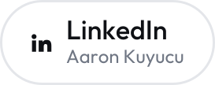
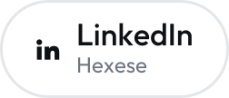
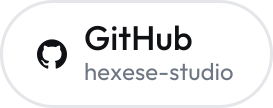
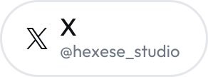

<picture>
  <source media="(prefers-color-scheme: dark)" srcset="assets/banner-v3-dark.svg">
  
</picture>

I study Computer Science at Goethe University Frankfurt and run **[Hexese](https://hexese.com)**, a one-person software studio.
I build software from the first sketch to the shipped page, and I care less about syntax than about whether a tool
actually makes someone's day easier.

 

## What I'm working on

<table>
  <tr>
    <td width="50%" valign="top">
      <h3>Hexese</h3>
      

        My studio for apps, servers and websites. <a href="https://hexese.com">hexese.com</a> is a static
        Next.js export with a strict Content Security Policy: a visit loads nothing from third-party
        servers, no fonts, no trackers, no CDN.
      

      
<a href="https://hexese.com"><b>hexese.com</b></a> · <a href="https://github.com/hexese-studio"><b>github.com/hexese-studio</b></a>

    </td>
    <td width="50%" valign="top">
      <h3>Amtsorakel</h3>
      

        A mobile app for German government letters: photograph a letter, get it explained in plain
        language, with amounts and deadlines quoted word for word from the page. It explains, it does
        not give legal advice. In development, no release date yet.
      

      
<a href="https://amtsorakel.de"><b>amtsorakel.de</b></a>

    </td>
  </tr>
</table>

The studio repositories under [hexese-studio](https://github.com/hexese-studio) are private.
I'm happy to walk through the code in a conversation.

 

## How I work

- **Issue → branch → PR → release.** Every change starts as an issue, lands through a pull request into `staging`, and reaches `main` only with a tagged release.
- **No third-party requests.** If a page promises not to send anything elsewhere, the build checks it before upload: no CDN, no external fonts, no tracking.
- **Checked before it ships.** Every build runs a gate (external calls, inline styles, leftover markers, legal pages) and stops on the first failure.

 

## Stack

| | |
| :-- | :-- |
| **Studio work** | TypeScript · React Native and Expo · Next.js (static export) · Supabase (Postgres, Auth, Storage, Edge Functions) · WebGL2 · GitHub Actions |
| **Exercises below** | HTML · CSS · vanilla JavaScript, no frameworks, no build step |
| **Also** | Python · Java · C · Git · Figma · accessibility and privacy from the start |

 

## Learning projects

Small, finished exercises from my first months of web development. Each one runs in the browser on GitHub Pages.

<picture>
  <source media="(prefers-color-scheme: dark)" srcset="assets/languages-v3-dark.svg">
  
</picture>

| Project | What it is | Live |
| :-- | :-- | :-- |
| **[Typing Trainer](https://github.com/aaronkuy/typing-trainer)** | Typing practice inspired by Monkeytype: speed, accuracy, local accounts with lifetime stats. | [Open](https://aaronkuy.github.io/typing-trainer/) |
| **[Book Finder](https://github.com/aaronkuy/book-finder)** | Book search on the Google Books API with async/await and fetch. | [Open](https://aaronkuy.github.io/book-finder/) |
| **[Weather](https://github.com/aaronkuy/weather)** | Current weather for any city via the OpenWeather API. | [Open](https://aaronkuy.github.io/weather/) |
| **[Journaling](https://github.com/aaronkuy/journaling)** | A journal with create, edit and delete, stored in localStorage, with a dark mode. | [Open](https://aaronkuy.github.io/journaling/) |
| **[To-do List](https://github.com/aaronkuy/to-do-list)** | Add, check off and delete tasks; entries persist in localStorage. | [Open](https://aaronkuy.github.io/to-do-list/) |
| **[Music Player](https://github.com/aaronkuy/music-player)** | Plays a fixed playlist with play, pause, next and previous. | [Open](https://aaronkuy.github.io/music-player/) |
| **[Calculator](https://github.com/aaronkuy/calculator)** | The four basic operations with a clean button grid. | [Open](https://aaronkuy.github.io/calculator/) |
| **[Tic Tac Toe](https://github.com/aaronkuy/tic-tac-toe)** | The classic game with win and draw detection. | [Open](https://aaronkuy.github.io/tic-tac-toe/) |

 

## Find me

<a href="https://www.linkedin.com/in/aaron-kuyucu-327a71385/"><picture><source media="(prefers-color-scheme: dark)" srcset="assets/social-linkedin-aaron-v3-dark.svg"></picture></a>
<a href="https://www.linkedin.com/company/hexese"><picture><source media="(prefers-color-scheme: dark)" srcset="assets/social-linkedin-hexese-v3-dark.svg"></picture></a>
<a href="https://github.com/hexese-studio"><picture><source media="(prefers-color-scheme: dark)" srcset="assets/social-github-hexese-v3-dark.svg"></picture></a>
<a href="https://x.com/hexese_studio"><picture><source media="(prefers-color-scheme: dark)" srcset="assets/social-x-hexese-v3-dark.svg"></picture></a>
<a href="https://www.instagram.com/hexese_studio"><picture><source media="(prefers-color-scheme: dark)" srcset="assets/social-instagram-hexese-v3-dark.svg"></picture></a>
<a href="https://www.youtube.com/@hexese"><picture><source media="(prefers-color-scheme: dark)" srcset="assets/social-youtube-hexese-v3-dark.svg"></picture></a>

 

Frankfurt am Main, Germany · <a href="https://hexese.com">hexese.com</a> · Brand icons from <a href="https://simpleicons.org">Simple Icons</a> (CC0); trademarks belong to their owners.
